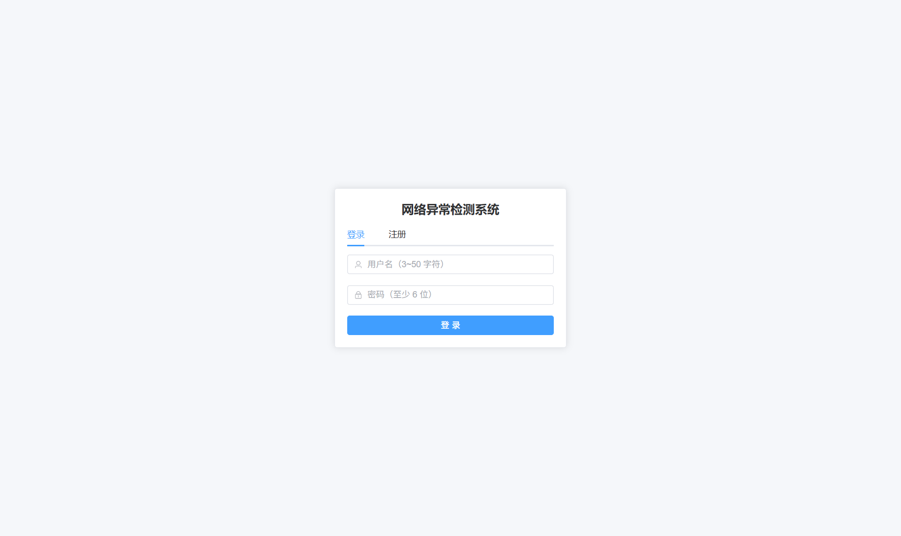
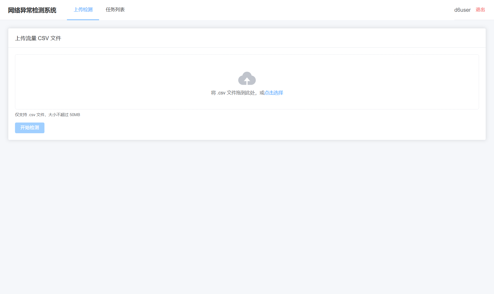
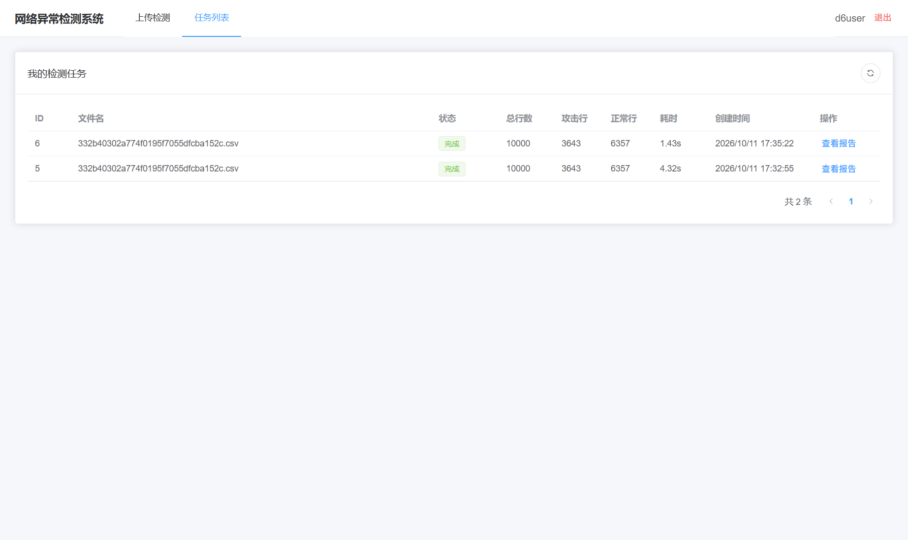
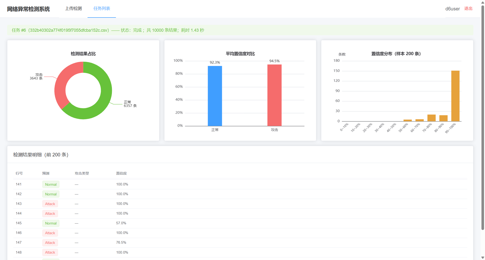

# 基于机器学习的网络异常检测系统

> 本科项目 | 软件工程 · 系统设计与实现方向
> 一个「带智能检测模块的 Web 系统」：浏览器上传流量记录 CSV，后端调用机器学习模型逐条判定异常/攻击，前端以任务列表与可视化报告呈现结果。

**场景定位**：校园网旁路监测（管理员批量离线分析）+ 钓鱼 URL 自查（师生单次自助排查），两种模式共用同一套「上传 → 异步检测 → 轮询状态 → 报告可视化」链路。

> **V2 产品化（product 分支）**：在项目定稿（main 分支，冻结可复现）之上完成四项产品化改造——多格式输入（CSV×2 自动嗅探 + PCAP 流特征提取）、现代数据集模型（CIC-IDS2017，约 283 万行）、召回优先阈值调优、告警中心与处置建议闭环。详见下文「V2 产品化能力」。

---

## 界面预览

| 登录 / 注册 | 上传检测 | 任务列表（轮询） | 检测报告（三图） |
|---|---|---|---|
|  |  |  |  |

报告页三张图：检测结果占比饼图、平均置信度对比柱图、置信度分布直方图，支撑人工复核排序。

product 分支新增第五页**告警中心**：菜单红点 15 秒轮询待处置数，告警按置信度降序展示，处置建议命令一键复制，支持确认（ack）/忽略（dismiss）。

---

## 技术栈

| 层 | 选型 |
|---|---|
| 前端 | Vue 3 + Vite + TypeScript + Element Plus + Pinia + Vue Router + ECharts |
| 后端 | FastAPI + Uvicorn + Pydantic v2 |
| 数据库 | MySQL 8.0（SQLAlchemy 2.0 同步 ORM + Alembic 迁移） |
| 认证 | JWT（python-jose）+ bcrypt 密码哈希 |
| 异步任务 | FastAPI BackgroundTasks（进程内任务 + 状态机轮询） |
| 检测模型 | v1：scikit-learn 随机森林（NSL-KDD，项目定稿）；v2：HistGradientBoosting（CIC-IDS2017，product 分支，`MODEL_VERSION` 一键切换） |
| 流量解析 | scapy（PCAP → 五元组双向流重组 → CICFlowMeter 命名流特征，product 分支） |

---

## 核心特性

- **上传即秒回**：大文件流式落盘（边写边校验后缀/大小，≤50MB），立即返回 `task_id`，检测在后台异步执行，不阻塞请求。
- **任务状态机**：`pending → running → success/failed`，前端每 2 秒轮询刷新，失败原因字段级透出。
- **列序严格校验**：加载 `features.json` 特征契约，缺列/多列/乱序均抛精确到列位的错误，杜绝静默误判。
- **失败零残留**：异常路径回滚脏结果行、清理临时文件，不留 orphan。
- **越权防护**：任务/结果/统计三个读接口统一归属校验（非本人且非 admin 返回 403）。
- **安全存储**：密码仅存 bcrypt 不可逆哈希，令牌不入库；全链路参数化查询防注入。

---

## V2 产品化能力（product 分支）

- **双模型共存**：`MODEL_VERSION=v1|v2` 切换。v1 = NSL-KDD 随机森林（项目资产原封不动）；v2 = CIC-IDS2017 全量训练的 HistGradientBoosting（召回优先胜出落盘 `model_v2.pkl`，不覆盖项目产物）。
- **多格式输入**：CSV 表头自动嗅探（NSL-KDD 41 列 / CIC-IDS2017 78 列均直接上传）；PCAP 原始抓包由服务端解析——scapy 五元组双向流重组，计算 CICFlowMeter 命名流特征（约 45 列可计算子集，缺失列填 0，降级如实声明）。
- **召回优先调优**：判定阈值 0.05~0.95 扫描 19 档后部署取 0.5（P=0.9937 / R=0.9996，决策见 DECISIONS.md）；告警置信门槛独立可配（默认 ≥0.90 才生成告警）。
- **告警与处置建议**：高置信 Attack 命中按攻击源去重落 `t_alert`；源为 IPv4 时自动生成 Windows 防火墙封禁命令（**只生成、绝不自动执行**，人工复制到管理员 PowerShell 执行）；同任务告警上限 500 条防刷屏。
- **Webhook 外发**：任务级摘要推送（generic `{"text"}` / 飞书群机器人两种格式），发送失败仅记日志、不阻断检测链路。

---

## 实测指标

> 模型指标采用官方 KDDTest+ 跨数据集泛化口径（诚实口径，非同分布内插虚高值）。

| 指标 | 数值 |
|---|---|
| 准确率 Accuracy | 0.7691 |
| F1（Attack 类） | 0.7518 |
| ROC-AUC | 0.9600 |
| 批量推理吞吐 | 14,655 条/秒 |
| 基线对照（全猜多数类） | 0.5692 |
| 上传接口响应 | 0.043 ~ 0.063 s |
| 1 万行端到端检测 | 1.35 ~ 4.03 s |

同分布随机划分口径 Acc=0.9989 仅作泛化分析对照（详见设计文档第 5 章），不进摘要。跨集攻击召回 61.4% 的漏报风险在设计文档第 7 章局限性中如实声明。

### V2 模型（CIC-IDS2017，product 分支）

> 同分布切分口径（train/test 同源随机切分，283 万行全量训练）——数字不代表跨网络泛化，真实流量效果未验证。

| 指标 | 数值 |
|---|---|
| 准确率 Accuracy | 0.9987 |
| 攻击召回 Recall | 0.9996（目标 ≥0.90 达成） |
| F1（Attack 类） | 0.9967 |
| ROC-AUC | 0.9998 |
| 全量训练耗时 | 31 s |
| 200 行 CSV 端到端（上传→报告） | 2.148 s（99/100 攻击行命中） |
| PCAP 流提取（合成 2 流） | 1.606 s |

---

## 快速开始

### 1. 环境准备

```bash
# Python 3.12.5，创建并激活虚拟环境
python -m venv venv
venv\Scripts\activate          # Windows
# source venv/bin/activate     # Linux/macOS

# 安装后端依赖
cd backend
pip install -r requirements.txt
```

### 2. 配置数据库

```bash
# 复制环境变量模板并按本机修改（DB_PASSWORD 等）
cp .env.example .env

# 建库（库名默认 anomaly_detection）
# MySQL 中执行：CREATE DATABASE anomaly_detection CHARACTER SET utf8mb4;

# 执行迁移建表（main 分支三张表；product 分支含 t_alert 共四张）
alembic upgrade head
```

### 3. 训练检测模型

模型产物与数据集**不随仓库分发**，演示前需本地训练一次：

```bash
# v1（项目模型）：将 NSL-KDD 的 KDDTrain+.csv / KDDTest+.csv 放到 backend/ml/data/ 下
python -m ml.train --data ml/data/KDDTrain+.csv --test ml/data/KDDTest+.csv
# 产出 backend/ml/artifacts/model.pkl 与 backend/ml/features.json

# v2（product 分支）：将 CIC-IDS2017 的 8 份 CSV 放到 backend/ml/data/cicids/MachineLearningCVE/ 下
python -m ml.train_v2
python -m ml.threshold_optimizer        # 阈值扫描，推荐值按需回填 .env
# 产出 backend/ml/artifacts/model_v2.pkl 与 backend/ml/features_cicids.json
```

`.env` 中 `MODEL_VERSION=v1|v2` 切换当前生效模型，两种模型的 CSV 上传格式后端均自动识别。

### 4. 启动后端

```bash
# 仍在 backend/ 目录
uvicorn app.main:app --host 127.0.0.1 --port 8000
# 健康检查：curl http://127.0.0.1:8000/health → {"status":"ok"}
```

### 5. 启动前端

```bash
# 新开终端，项目根目录
cd frontend
npm install
npm run dev
# 浏览器访问 http://localhost:5173（Vite 代理 /api → 127.0.0.1:8000）
```

### 6. 演示动线

注册账号 → 登录 → 上传一份 1 万行 CSV（v1 用 `ml/data/KDDTest+.csv` 前 1 万行；v2 用 CIC-IDS2017 抽样 CSV）→ 任务列表观察状态从"排队中"变"完成" → 进入报告页查看三张统计图 → 告警中心查看红点与处置建议命令并点击确认（ack）。关掉后端时页面弹「无法连接后端服务」提示而非白屏。

---

## 接口概览

| 方法 | 路径 | 说明 |
|---|---|---|
| POST | `/api/v1/auth/register` | 注册（用户名唯一，bcrypt 哈希入库） |
| POST | `/api/v1/auth/login` | 登录，返回 JWT |
| GET | `/api/v1/auth/me` | 当前用户信息 |
| POST | `/api/v1/tasks` | 上传 CSV / PCAP 建检测任务（异步，秒回 task_id） |
| GET | `/api/v1/tasks` | 我的任务列表（分页） |
| GET | `/api/v1/tasks/{id}` | 任务详情（前端轮询 status） |
| GET | `/api/v1/tasks/{id}/results` | 检测结果分页 |
| GET | `/api/v1/tasks/{id}/stats` | 聚合统计（图表数据源） |
| GET | `/api/v1/alerts` | 我的告警列表（分页/状态过滤，open 优先） |
| GET | `/api/v1/alerts/count` | open 告警数（菜单红点轮询） |
| PUT | `/api/v1/alerts/{id}/ack` | 确认处置（open → acked） |
| PUT | `/api/v1/alerts/{id}/dismiss` | 忽略告警（open → dismissed） |
| GET | `/health` | 存活探针 |

统一返回结构 `{code, msg, data}`。项目接口完整请求/响应示例见 [`docs/api.md`](docs/api.md)；V2 告警四接口签名见 [`backend/app/routers/alerts.py`](backend/app/routers/alerts.py)。

---

## 项目结构

```
backend/
  app/
    main.py            # FastAPI 入口、路由注册、CORS
    config.py          # 环境变量配置
    database.py        # 同步 engine / SessionLocal
    models.py          # ORM（t_user / t_detection_task / t_detection_result / t_alert）
    schemas.py         # Pydantic 请求/响应模型
    security.py        # bcrypt 哈希 + JWT 签发校验
    deps.py            # get_db / get_current_user
    routers/           # auth / tasks / results / admin / model_api / alerts（V2）
    services/          # detection.py（异步检测链路）/ alert_service.py（V2 告警+处置建议）
    utils/             # file_io.py（流式上传 + 失败清理，V2 放行 .pcap）
  ml/                  # train / predict / features.json（v1 冻结）+ train_v2 / threshold_optimizer / schema_registry / flow_extract / cicids_data（V2）
  alembic/             # 数据库迁移（三表 + t_alert）
frontend/
  src/
    views/             # 登录注册 / 上传 / 任务列表 / 报告 / 告警中心（V2）五页
    api/               # axios 实例 + 拦截器（JWT/错误映射/静默轮询）
    stores/ router/    # Pinia（auth + alerts 红点轮询）+ 路由守卫
docs/
  schema.sql / api.md  # 数据库与接口文档
  design/              # 设计文档素材与正文初稿
scripts/auto_log.py    # 记录一致性校验
```

---

## 已知局限（如实声明）

- **进程内任务模型**：BackgroundTasks 服务重启时 running 任务滞留、无自动恢复；并发压测实测上传 P95=1651ms，主因即队列积压抢占资源。生产应替换为 Celery + 消息队列。
- **二分类输出**：仅判定 Normal/Attack，`attack_type` 细分字段预留未填。
- **PCAP 特征降级**（V2）：服务端可计算约 45 列流特征子集，与 CIC-IDS2017 官方 78 列契约存在缺失列（填 0 处理），PCAP 判定结果参考意义弱于原生 CSV；.parquet 仍未支持。
- **泛化口径**（V2）：v2 指标为同分布切分口径，真实网络效果未验证；v1 跨集召回 61.4% 的项目口径不变。系统定位仍为旁路事后分析 + 高置信告警初筛，不承诺实时拦截。
- **不自动阻断**（V2）：处置命令仅生成、供人工审核后手动执行（自动阻断在 CONTEXT.md §10.2 永久禁止），告警→处置存在分钟级人工时延。

---

## 说明

- 本项目为本科项目，检测能力仅用于公开数据集（NSL-KDD / CIC-IDS2017）的离线分析与教学演示，**不对任何未授权网络发起主动探测**。
- `main` 分支 = 项目定稿（冻结可复现）；`product` 分支 = V2 产品化改造（本文新增能力均在此分支）。
- 系统仅留存登录名、不可逆密码哈希与判定结果，令牌不入库。
- 依赖清单以 [`backend/requirements.txt`](backend/requirements.txt) 为白名单；开发全程记录见 [`CHANGELOG.md`](CHANGELOG.md)、技术决策见 [`DECISIONS.md`](DECISIONS.md)。
